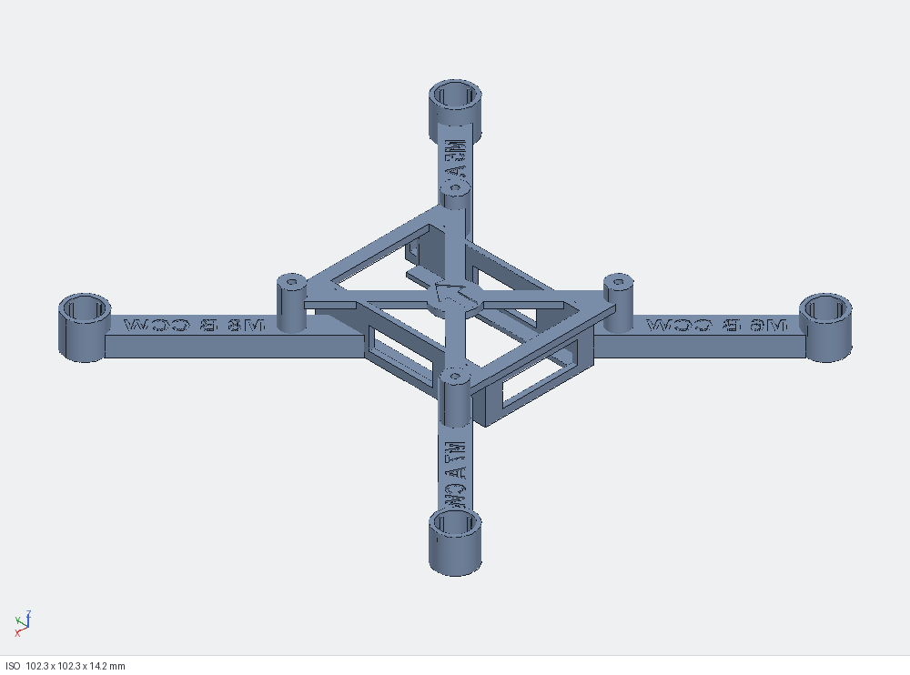

# Pluto Drone PETG Frame

**An open-source, 3D-printable replacement frame for the Drona Aviation Pluto 1.2 nano drone.**

It's one PETG part that takes all of the kit's stock electronics: the Primus V5 flight controller, the rubber dampers and screws, the four coreless motors, the 55 mm A/B props, the Pluto 600 battery and the canopy. If your stock frame breaks, or you just want to print your own, download the STL, print it in about 40 minutes and move your parts across.



> **Compatibility (v1):** works best with a **plain Pluto 1.2, with no extra modules**. This version has no mounting points, cable routing or strain relief for add-ons (camera, sensors, LEDs, buzzer, payload holders). A module may still work, but it may also put stress on the board and its connectors. Support for modules will be improved in future versions. Details: [docs/COMPATIBILITY.md](docs/COMPATIBILITY.md).

> **Unofficial community project.** Not made, endorsed or supported by Drona Aviation. "Pluto", "Primus" and "Drona Aviation" are names of their products and company and are used here only to say what this frame fits. Fly safely and follow your local drone rules.

---

## Download and print

| file | what it is | P1S time / weight* |
|---|---|---|
| [`out/pluto_frame.stl`](out/pluto_frame.stl) ([.3mf](out/pluto_frame.3mf), [.step](out/pluto_frame.step)) | **The frame** for 0720 motors (7 x 20 mm), with the +0.15 mm shrink allowance | about 39 min, 9.3 g |
| [`out/motor_fit_coupon.stl`](out/motor_fit_coupon.stl) ([.3mf](out/motor_fit_coupon.3mf), [.step](out/motor_fit_coupon.step)) | **Motor fit coupon**: 20 test sleeves (5 motor sizes x 4 grip levels), each identical to the frame's motor tube, with the same +0.15 mm allowance | about 43 min, 9.5 g |
| [`out/pluto_canopy_flat.stl`](out/pluto_canopy_flat.stl) | **Canopy** (flat, vented): protects the Primus V5, attaches to the stock screws and dampers. Print it as is (roof already on the bed), no supports, no brim | about 14 min, 2.9 g |

\* Bambu Lab P1S, 0.4 mm nozzle, PETG, 0.16 mm layers, 3 walls, 40% gyroid, 4 mm brim (included in the weight). The frame is about 9.0 g once the brim is peeled off.

The frame and coupon are already in print orientation: flat side down, **no supports**. The canopy is also print-ready: roof down, no supports. Full settings are in [docs/PRINTING.md](docs/PRINTING.md).

> **Canopy:** `out/pluto_canopy_flat.stl` is the flat, vented canopy. It attaches with the stock screws and dampers. Print it roof-down with no supports and no brim.

**Not sure which motors you have, or printing on a different printer?** Print the coupon first (or just its 7.0 row). See [docs/MOTOR_FIT_TEST.md](docs/MOTOR_FIT_TEST.md).

---

## At a glance

| | |
|---|---|
| Size | 102.3 x 102.3 x 14.2 mm, one piece |
| Motor layout | 93 x 93 mm square, 131.5 mm motor-to-motor diagonal (same as stock) |
| Motors | 0720 coreless (7 mm x 20 mm), press-fit into crush-ribbed tubes with a bottom lip |
| Flight controller | Primus V5 on the stock rubber dampers, on 4 posts in a 41 x 41 mm pattern, stock M2 screws (1.8 mm pilot holes) |
| Battery | Pluto 600 (37 x 24 x 8 mm) slides in from the front, under the board |
| Frame weight | about 9.0 g printed (8.8 g solid model) |
| Estimated all-up weight | about 55 g (stock spec: 60 g) |
| Material | PETG |
| Design checks | 49 automated geometry checks pass (fits, clearances, wall thickness, printability); see [docs/DESIGN.md](docs/DESIGN.md) |

## Features
- **Engraved build labels on every arm:** board port, prop letter and spin direction, plus a front arrow on the deck to line up with the board's arrow. You don't need the manual open to wire it.
- **Same mounting stack as stock:** post, rubber damper, board, canopy tab, screw. The board touches only the dampers (1.4 mm clearance to the frame at the closest point), so the stock canopy fits too.
- **Motor tubes sized from a real fit test.** Every tube has 4 crush ribs and a +0.15 mm shrink allowance, so the motor presses in firmly and stays put. Why the allowance is there: [docs/TOLERANCES.md](docs/TOLERANCES.md).
- **Keyhole at the bottom of each tube:** the motor plug drops through and the lead runs straight into a covered channel under the arm, away from the props.
- **Battery bay** with floor rails, a rear stop and a little hook at the front left for the battery leads.
- **Prints in one go with no supports:** the arm tops, window tops and deck bars are all short bridges.

### Arm labels (read from behind the drone)

| arm | label | board port | prop | spin (seen from above) |
|---|---|---|---|---|
| front-left | `M5 A CW` | M5 | A | clockwise |
| front-right | `M8 B CCW` | M8 | B | counter-clockwise |
| rear-left | `M6 B CCW` | M6 | B | counter-clockwise |
| rear-right | `M7 A CW` | M7 | A | clockwise |

This matches the A/B prop figure in the Pluto 1.2 manual and the QuadX motor order in Drona's MagisV2 firmware.

---

## Compatibility
**v1 works best with the plain Pluto 1.2: board, motors, props, battery and canopy, with no extra modules.** That's the setup every design check and the simulation used.

**Add-on modules** (the Wi-Fi camera, sensor and motor modules, Drona's printed holders for a buzzer, LED, gas, motion or sound sensor, payload holders) **aren't supported in this version**, because the frame has no support system for them:
- **no mounting points**, so a module's weight ends up hanging on the board, its small connectors and their solder joints, which aren't made to carry loads, especially through landings and crashes;
- the board sits on **soft rubber dampers**, and extra mass or a pulling cable changes the vibration isolation and can tilt the board, causing drift and noisy sensor readings;
- **less spare thrust:** with 0720 motors, a full 10 g payload takes it from about 1.6 to about 1.4 thrust-to-weight and from 61% to about 73% hover throttle;
- **no cable routing**, so loose cables can reach the props, and an off-centre module upsets the balance.

A light module **may still work**, but in this version it **may also put stress on the board and connectors**. If you try one, strap the module to the frame (never let it hang from its cable), leave slack in the cable, keep it centred and recalibrate. **Module support will be improved in future versions:** a frame-mounted accessory deck, a camera mount, cable clips and strain relief, balanced mounting positions, checks with modules fitted, prop guard points, and an 8520 option. Full write-up: [docs/COMPATIBILITY.md](docs/COMPATIBILITY.md).

## Why the tolerances matter (short version)
Printed holes come out a little smaller than designed. On our Bambu P1S in PETG, a sleeve drawn exactly to the motor's size plus the intended grip was just too tight: the 0720 motor stopped short of the lip. Adding **+0.15 mm** to the bore and to the rib circle made the motor press fully home and hold firmly. That allowance is built into both the frame and the coupon. If your printer prints holes tighter or looser, use the coupon to check, and change one number in the source. The full story, with numbers: **[docs/TOLERANCES.md](docs/TOLERANCES.md)**.

## Build
Step by step, with checks before the first flight: **[docs/ASSEMBLY.md](docs/ASSEMBLY.md)**. In short:
1. Fit the dampers to the board, set it on the posts with the arrows matching, and screw it down without squeezing the dampers.
2. Feed each motor's plug down its tube and out through the keyhole, then press the motor down onto the lip.
3. Tuck the leads into the channels under the arms and plug them into the ports shown on the labels.
4. Fit the canopy, then the props (A on the A arms, B on the B arms), then slide the battery in from the front.
5. Calibrate the accelerometer and magnetometer in the app, run the motor test, then make a short low hover.

## Will it fly well?
The motor positions and the mounting are the same as stock, so the stock flight controller tuning applies unchanged. The simulation ([docs/SIMULATION.md](docs/SIMULATION.md)) estimates:
- **Thrust-to-weight** about 1.6: about 22 g of thrust per 0720 motor at full throttle, against about 55 g all-up. It hovers at about 61% throttle.
- **Balance:** the centre of gravity sits within 0.3 mm of the thrust centre.
- **Attitude control:** a closed-loop roll test settles in about 0.2 s without any motor running out of headroom.
- **Arm stiffness:** the arms flex 0.08 mm at full thrust. Their first vibration mode is at 140 Hz, well clear of the 350 Hz prop rate at hover.

These are model estimates, not thrust-stand measurements. **No flight test had been done when this was published.** Please open an issue with your results.

## Known limitations
- **No support for add-on modules yet:** best with a plain Pluto 1.2; see [Compatibility](#compatibility).
- **The stock prop guards don't clip on.** They lock onto lugs on the stock motor mounts, and those aren't documented.
- **The motor tubes are for 0720 motors.** For other sizes (the Primus also supports 0615, 8520 and 1020 motors), change `MOTOR_D` in the source and regenerate; see below.
- **Hole spacing and motor positions were measured from Drona's to-scale manual drawing.** The 41 mm hole spacing looked right against a real board, but wasn't measured with calipers. The screws were assumed to be M2. Sources and confidence levels are in [docs/SPECS.md](docs/SPECS.md).
- **0720 motors leave less spare thrust than 8520s.** Keep add-ons within the manual's 10 g payload.

---

## Modify it
Everything is parametric Python ([build123d](https://github.com/gumyr/build123d)). Every dimension lives in [`src/p_params.py`](src/p_params.py), with comments on where each number came from.

```bash
pip install build123d
python tools/export.py              # rebuilds out/pluto_frame.* and out/motor_fit_coupon.*
```

| want to... | change in `src/p_params.py` |
|---|---|
| use other motors (e.g. 8520) | `MOTOR_D = 8.5` |
| tune the motor grip | `SQUEEZE` (0.1 = lighter, 0.3 = tighter) |
| match your printer's hole shrink | `HOLE_COMP` (0.15 measured on a P1S in PETG) |
| different board hole spacing | `HOLE_SQ` |
| M1.6 / M2.5 screws | `PILOT_D` = 1.4 / 2.2 |

`kerf_scripts/` holds the same build with its 49 design checks attached (they ran in the Kerf CAD tool). `tools/sim.py` reruns the simulation, and `tools/slice.py` produces Bambu Studio estimates. See [docs/DESIGN.md](docs/DESIGN.md).

## Repository layout
```
out/            print files (STL, 3MF, STEP), already in print orientation
docs/           COMPATIBILITY, TOLERANCES, MOTOR_FIT_TEST, PRINTING, ASSEMBLY, SIMULATION, SPECS, DESIGN + images and result data
src/            parametric source: p_params (all dimensions), p_parts (frame), p_coupon (fit coupon), p_asm (stand-ins for the bought parts)
kerf_scripts/   builds with design checks: frame.py (49 checks), part.py (export pose), coupon.py (87 checks)
tools/          export.py, sim.py + plot_sim.py, slice.py, local check helpers, label stroke check
```

## Contributing
Flight reports, photos, fit results on other printers and motor sizes, module-mount requests (with the module's weight, size and connector position) and prop-guard designs are all very welcome. Open an issue or a pull request. If you change the shrink allowance for your printer, please say which printer, filament and settings you used, so others can compare.

## Credits and licence
Specs were researched from Drona Aviation's public Pluto 1.2 manual, their hardware parts pages and the open-source MagisV2 firmware (links in [docs/SPECS.md](docs/SPECS.md)). No Drona images or files are redistributed here.

- Design files (STL, 3MF, STEP) and documentation: **[CC BY 4.0](LICENSE-CC-BY-4.0)**. Use, modify and share them, including commercially, with credit.
- Source code (`src/`, `kerf_scripts/`, `tools/`): **[MIT](LICENSE)**.
