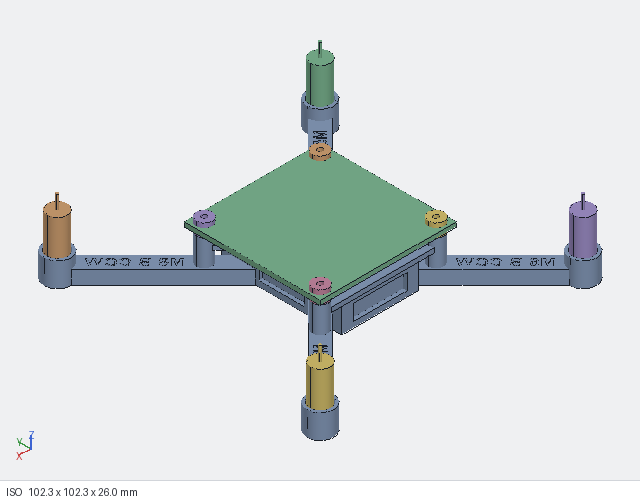

# Assembly

You need the parts from a Pluto 1.2 kit: the Primus V5 board, 4 rubber dampers and 4 screws, 4 motors, props (A and B), the Pluto 600 battery, the canopy, and the prop tool and screwdriver. The order follows the official manual.

*CAD check of the assembly: board, dampers, motors and battery shown as simple stand-ins.*

## Orientation
- **Front** = the open end of the battery bay, next to the small hook. The arrow engraved on the deck points to the front.
- The board's front is the Wi-Fi module end, marked with an arrow on the board.
- Arm labels read correctly when you look from behind the drone.

## 1. Flight controller
1. Push the 4 rubber dampers into the board's corner holes.
2. Set the board on the 4 posts with **its arrow over the deck arrow**.
3. Drive the 4 screws down through the dampers into the posts. **Don't squeeze the dampers**: stop when the screw head just sits on them. The posts have 1.8 mm pilot holes, so the first time the screws cut their own thread. Go slowly and keep the screwdriver straight.
4. From the side, check that the board touches only the dampers. The design leaves at least 1.4 mm between the board and the frame.

## 2. Motors
Work arm by arm: the label tells you which motor port and prop it gets.
1. Feed the motor's plug **down the tube from the top**.
2. At the bottom, **turn the plug flat** (its thin side across the slot) and push it out through the **keyhole**: the round hole in the lip plus the slot on the arm side.
3. Draw the lead through, then **press the motor down with the prop tool until it sits on the lip**. The 4 crush ribs make this a firm push, the same as on a test sleeve.
4. Tuck the lead into the **channel under the arm**. It comes out next to the damper post, close to that arm's port on the board's side edge.
5. Plug it into the port on the label: **M5** front-left, **M8** front-right, **M6** rear-left, **M7** rear-right.

To remove a motor, push up on its end cap from below through the keyhole.

## 3. Canopy
Loosen the 4 screws a little, slide the canopy's 4 tabs between the screw heads and the dampers, then tighten again (still without squeezing the dampers).

## 4. Props
Fit **A** props on the arms labelled `A` (front-left, rear-right, clockwise) and **B** props on the arms labelled `B` (front-right, rear-left, counter-clockwise). The letter is moulded near each prop's hub. Use the prop tool and press them straight on.

## 5. Battery
Slide the battery in **from the front**, under the deck, until it touches the rear stop. Press the two leads into the slot in the hook at the front-left, then plug into the board's battery connector on its left edge.

## 6. Before the first flight
1. In the Pluto Controller app: calibrate the **accelerometer** (on a level surface) and the **magnetometer**. The board sits on a new frame, so don't skip this.
2. **Motor test** ("Spin all"): every motor should spin, in the direction on its label.
3. **First hover:** about 30–50 cm off the ground, for a minute, in an open room. It should hold steady, with no wobble or buzzing and no visible arm flex.
4. Land and touch the motors. Warm is normal; too hot to hold means a prop is on the wrong motor or something is rubbing.

If it drifts, trim it in the app as the manual describes. Please report how it flew in an issue.
