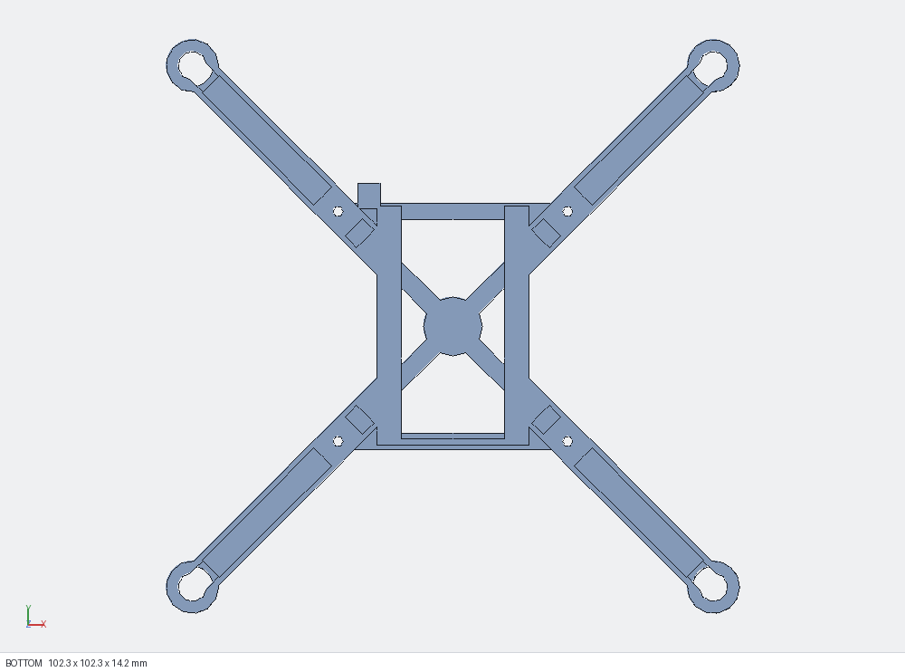

# Design notes

*Underside: the wire channels under the arms, the keyholes at the tube bottoms, the battery rails, and the hook at the front-left (this render is mirrored left-right).*

## Layout (mm; +Y = front, +X = right, z = 0 = print bed / ground)
- **Battery bay:** 24.8 wide x 8.6 tall inside, floor rails 3.2 x 1.0 under the battery edges, a rear stop at y = -20, and an open front. Windows in the side walls and the rear stop save weight.
- **Deck** (z 9.6–11.2): diagonal bars between the posts, front and rear bars, a centre hub with the front arrow, and small triangular gussets wherever a diagonal bar meets a front or rear bar. Without the gussets those 45 deg corners would print as knife-thin slivers.
- **Damper posts:** 5.4 mm diameter, full height (z 0–14.2) so they stand on the bed, with tops 3 mm above the deck and 1.8 mm pilot holes all the way through.
- **Arms:** Π section, 6.2 wide x 4.8 tall, with a 1.2 mm top plate carrying the engraved label (0.4 deep) and 0.9 mm side walls around a wire channel open underneath. The section between the bay wall and the post is solid for strength.
- **Motor tubes:** at (±46.5, ±46.5). Bore 7.55, 4 crush ribs to a 6.95 circle, 0.9 mm wall, 8.5 tall, 1.0 mm lip with a 5.1 hole, plus a 4.0 mm keyhole slot toward the arm.
- **Battery-lead hook:** in front of the left bay wall, with its slot running sideways (it used to run backwards and cut into the front-left arm).

## Design checks
`kerf_scripts/frame.py` builds the frame together with simple stand-ins for the bought parts (board, dampers, motors, plugs, props, battery, canopy) and runs **49 checks** on the exact CAD geometry. All pass:
- single watertight solid, flat base, fits the print bed, 9.0 g limit on the solid model;
- **thinnest wall at least 0.8 mm** (two 0.4 mm lines). Measured: 0.85 mm. This is checked on the body without the engraving, because the wall sampler reads letter edges as 0 mm; the letters have their own checks;
- engraving: no hidden voids, at least 0.8 mm of material under the letters, at least 0.45 mm between letters, letter holes at least 0.8 mm, labels fit on the arms (the letter strokes, about 0.56 mm, are checked by `tools/text_check.py`);
- board: 41 x 41 post pattern, posts carry the damper flange, **board at least 1.0 mm clear of the frame** (measured 1.4), dampers don't cut into anything;
- motors: the motor passes down to the lip, the plug passes through the tube and out of the keyhole, **the tube equals the fit-tested sleeve** (bore 7.55, ribs 6.95, lip 5.1, wall 0.9, height 8.5);
- battery: sits in the bay, slides out through the front, at least 0.4 mm headroom;
- props: at least 8 mm from the frame (measured 10.2), at least 3 mm from the board (6.5), at least 1 mm from a canopy envelope (4.4), and 38 mm tip-to-tip between neighbouring props.

`kerf_scripts/coupon.py` runs **87 checks** on the fit coupon, including that every sleeve uses the frame-tube formulas with the +0.15 allowance and that the corner label shows it.

These scripts were run in the Kerf CAD tool, but the geometry itself is plain build123d. `tools/export.py` rebuilds the print files with build123d alone, and `tools/local_contracts.py` reruns most of the checks locally.

## Things we learned (useful if you modify it)
- Sketches that come out mirrored (e.g. a triangle placed at the opposite corner) are wound the other way, and `extrude` then builds them *downwards*. Always pass `dir=(0, 0, 1)` for engraving and gussets.
- Engraved text needs a heavy font at a size of about 5 for 0.4 mm nozzles. At 3.6 the strokes were narrower than a single extrusion line.
- Printed press fits need a shrink allowance; see [TOLERANCES.md](TOLERANCES.md).
