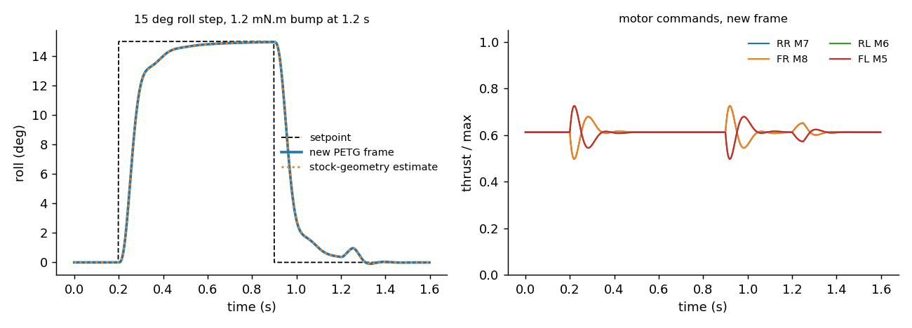

# Simulation

`tools/sim.py` (run with `python tools/sim.py <printed frame grams>`) builds the frame from the source, then checks mass, thrust, balance, arm stiffness and attitude control. Results are in [`sim_results.json`](sim_results.json); `tools/plot_sim.py` draws the attitude plot. **These are engineering estimates from models and published motor data, not measurements.** Flight reports are welcome.

## Mass budget (grams)

| part | g | source |
|---|---|---|
| Primus V5 board | 10.4 | manual |
| Pluto 600 battery | 16.0 | Drona parts page |
| 4 x 0720 motors | 12.8 | about 3.2 g each (typical; not published) |
| 4 x 55 mm props | 2.4 | estimate |
| 4 dampers + 4 screws | 1.4 | estimate |
| Canopy | 3.0 | estimate |
| **This frame** | **8.95** | sliced on a P1S, without the brim |
| **All-up** | **about 55** | stock spec: 60 g |

## Thrust: a motor model, not a guess
Each motor is modelled as a brushed DC motor using Drona's published 0720 figures: 0.8 ohm coil plus brush, 0.18 A no-load current, 50,000 rpm at 3.7 V. It drives a 55 mm prop (thrust coefficient 0.10, power coefficient 0.05, typical for small two-blade props). The model includes battery internal resistance (shared by 4 motors) and the MOSFET drop, and is solved for the full-throttle operating point:

| | 0720 (this build) | 8520 (same model, for comparison) |
|---|---|---|
| Full-throttle speed | about 26,900 rpm | about 29,500 rpm |
| Current per motor | about 1.5 A | |
| Thrust per motor | **about 22 g** | about 27 g |

- **Thrust-to-weight: about 1.6.** It hovers at **about 61%** of max thrust (about 21,000 rpm).
- That's enough for controlled indoor flying, the kit's intended use, and since the motors are the stock ones it should be close to a stock Pluto 1.2. Keep add-ons within the manual's 10 g payload.

## Balance and inertia
- With the battery against the rear stop, the centre of gravity sits **0.27 mm** from the thrust centre, horizontally.
- Inertia: about 4.7e-5 kg m² in roll and pitch, 8.7e-5 in yaw. The motors dominate, and they're in the stock positions, so the **stock Magis flight controller tuning applies**.

## Closed-loop attitude test
This is a rigid-body model with the firmware's QuadX mixer (motor order REAR_R, FRONT_R, REAR_L, FRONT_L, as in MagisV2 `flight/mixer.cpp`), a 35 ms motor lag, and a generic angle-then-rate controller. It is not Drona's exact gains.

- A 15 deg roll step reaches 90% in **0.16 s** and settles in **0.22 s**, with no overshoot.
- A 1.2 mN m bump is held to **under 1 deg**.
- **No motor ever reaches full throttle**, so there's control headroom left.

## Arm structure
Each arm is a Π section, 6.2 mm wide and 4.8 mm tall: a 1.2 mm top plate carrying the label, and 0.9 mm side walls around the wire channel. It's modelled as a 34 mm cantilever from the damper post, with printed PETG at E = 1.8 GPa:

| check | result |
|---|---|
| Tip deflection at full thrust (+15%) | 0.08 mm |
| Root stress at full thrust | 1.0 MPa (printed PETG about 40 MPa) |
| First bending mode, vertical / sideways | 140 Hz / 235 Hz |
| Prop speed at hover | about 350 Hz, so the arm resonances sit well below the main shaking from the props |
| Static tip load that would bend the arm root permanently, down / sideways | about 9.7 N / 26 N |

## Not modelled: add-on modules
Everything here is for the plain Pluto 1.2 with no extra modules. What a module would do to thrust margin, balance and board vibration is covered in [COMPATIBILITY.md](COMPATIBILITY.md).

## Limits of the model
- The prop coefficients are textbook values, and motor and prop masses are typical rather than weighed.
- No aerodynamic drag, ground effect or blade flapping.
- The attitude controller is generic, so it shows the frame isn't the limiting factor, not the exact firmware response.
- Crash loads are static equivalents, not drop-test results.
