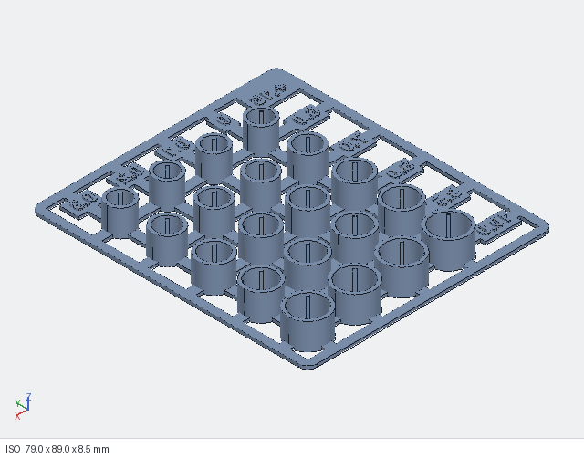

# Tolerances: why the frame and coupon have a +0.15 mm shrink allowance

**Short version:** 3D-printed holes come out smaller than the CAD says. The first test print showed that a motor tube drawn exactly to "motor size plus the intended grip" was too tight to seat the motor. A second test sleeve, opened up by 0.15 mm, let the motor press fully home and hold firmly. That +0.15 mm is now built into every motor tube on the frame and every sleeve on the fit coupon.

---

## 1. The problem: online sources disagree on the motor size
Drona Aviation doesn't publish the Pluto 1.2's motor size in one clear place:
- the Pluto 1.2 manual only says "Brushed Coreless Motor";
- Drona's hardware parts page lists four motor sizes the Primus flight controllers support: **0615, 0720, 8520 and 1020**;
- the spare-motor product page calls its motors "1020";
- the can's proportions in the manual's assembly photo looked closest to an 8520.

A wrong guess means either a motor that won't go in, or one that falls out in flight. So instead of guessing, we printed a test piece and tried the real motors in it.

## 2. The fit coupon
[`out/motor_fit_coupon.stl`](../out/motor_fit_coupon.stl) has 20 sleeves: 5 motor diameters (6.0, 7.0, 8.0, 8.5, 10.0 mm) x 4 grip levels ("squeeze": 0, 0.1, 0.2, 0.3 mm). Each sleeve is an exact copy of the frame's motor tube:

- 0.9 mm wall, 8.5 mm tall, printed upright, the same way the frame prints;
- a 1.0 mm lip at the bottom that the motor sits on, with a hole for the lead and for pushing the motor back out;
- a bore 0.4 mm larger than the motor, so the can only touches the ribs;
- **4 crush ribs** whose tips sit on a circle smaller than the motor by the squeeze. The ribs are what grip. They deform slightly as the motor goes in, which makes the fit much less sensitive to small print variations than a plain round hole.

Because each sleeve really is the frame tube, a sleeve that grips well on the coupon grips the same way on the frame, provided both are printed the same way.

## 3. What the first print showed
Printed on a **Bambu Lab P1S** (0.4 mm nozzle, PETG, 0.16 mm layers, 3 walls) with **no allowance**:
- the motors belonged in the **7.0 mm row**, so they're **0720** motors (7 x 20 mm);
- in the **7.0 / 0.2** sleeve the motor almost went all the way down, but stopped short of the lip. The fit was right, but the printed sleeve was slightly too small.

## 4. Why printed holes come out small
This is normal for FDM printing, and the amount depends on the printer, filament and settings:
- **Facets:** the slicer turns a circle into straight segments, and the flats sit inside the true circle.
- **Line width:** an extruded line spreads a little wider than planned, and on the inside of a hole that extra width eats into the opening.
- **PETG flow:** PETG swells a little as it leaves the nozzle and is often printed with a slightly generous flow. Both add material.
- **Seam and first layer:** the seam blob and first-layer "elephant's foot" stick inward too.

Together these typically take **0.1–0.3 mm off a small hole's diameter**. A 7 mm press fit with 0.2 mm of intended grip simply has no room for that.

## 5. The fix: +0.15 mm on the bore and on the rib circle
We printed one bare sleeve (no plate, no labels, to save filament) for 7.0 mm / 0.2 squeeze, with both the bore and the rib circle **0.15 mm larger**:

| 0720 tube | drawn without allowance | drawn with +0.15 (current) |
|---|---|---|
| Bore between the ribs | 7.40 mm | **7.55 mm** |
| Rib tip circle | 6.80 mm | **6.95 mm** |
| Bottom lip hole | 5.10 mm | 5.10 mm (unchanged) |
| Wall / height / lip | 0.9 / 8.5 / 1.0 mm | 0.9 / 8.5 / 1.0 mm |

**Result: the motor pressed fully down onto the lip and held firmly.** That's the fit the frame now uses.

**Why both the bore and the ribs move by the same amount:** the ribs set the grip, and the bore keeps the can off the wall everywhere else. Moving both together keeps the designed 0.2 mm squeeze and the 0.4 mm bore clearance relative to each other, and only cancels out the printer's shrink.

In the source this is one number, `HOLE_COMP = 0.15` in [`src/p_params.py`](../src/p_params.py). It feeds both the frame (`TUBE_BORE`, `RIB_D`) and the coupon (`CP_COMP`).

## 6. Where the allowance is applied now
- **Frame** ([`out/pluto_frame.stl`](../out/pluto_frame.stl)): all four motor tubes are 7.55 mm bore with a 6.95 mm rib circle. One of the 49 design checks requires the tube to equal the tested sleeve exactly, so a future edit can't drift away from what was proven to fit.
- **Fit coupon** ([`out/motor_fit_coupon.stl`](../out/motor_fit_coupon.stl)): every sleeve, on every row, carries +0.15. The corner label reads **`+.15`** instead of `D`, so you can tell this version from an uncompensated one. So the columns read as the squeeze you actually get on a printer that shrinks holes about as much as a P1S does.

## 7. The same reasoning applied to the plug keyhole
With a 7 mm motor, the 5.1 mm lip hole is smaller than the motor's 2-pin plug (about 4.4 x 3.2 mm, 1.25 mm pitch). Each tube therefore has a slot running from the centre of the lip out through the wall on the arm side, so the plug can drop through and the lead runs into the arm channel. At 3.7 mm wide the slot left only 0.20–0.25 mm per side around the plug, which shrink could close up entirely. It was widened to **4.0 mm**: 0.35–0.40 mm per side, measured on the CAD. The crush ribs sit 45 deg away and are untouched.

## 8. Using this on your own printer
The +0.15 mm is what worked on one P1S with PETG. Your printer may shrink holes more or less.
1. **Print the coupon** (it already has +0.15) with exactly the settings you'll use for the frame.
2. **Find your motors' row** (the `0` column should take the motor with almost no force and no wobble).
3. **Find the column** in that row where the motor presses fully onto the lip, stays put when you shake it upside down, and doesn't creep up when you pull a prop off.
4. **Read off the result:**
   - **7.0 row, 0.2 column:** your printer behaves like ours. Print the frame as it is.
   - **7.0 row, 0.3 column** (0.2 was loose): your printer shrinks holes less. Set `SQUEEZE = 0.3`, or lower `HOLE_COMP` by about 0.1.
   - **7.0 row, 0.1 column** (0.2 too tight): your printer shrinks holes more. Set `SQUEEZE = 0.1`, or raise `HOLE_COMP` by about 0.1.
   - **Another row:** you have different motors. Set `MOTOR_D` to that row.
5. Run `python tools/export.py` and print the regenerated frame.

The other printed holes are less critical. The **M2 screw pilot holes** (1.8 mm) are meant to be tight so the screw cuts its own thread. If a screw spins loose, use `PILOT_D = 1.6`; if a post starts to split, use 2.0.

Please share what worked for you (printer, filament, settings, and the column you picked) in an issue. A table of real results is the most useful thing this project could collect.
